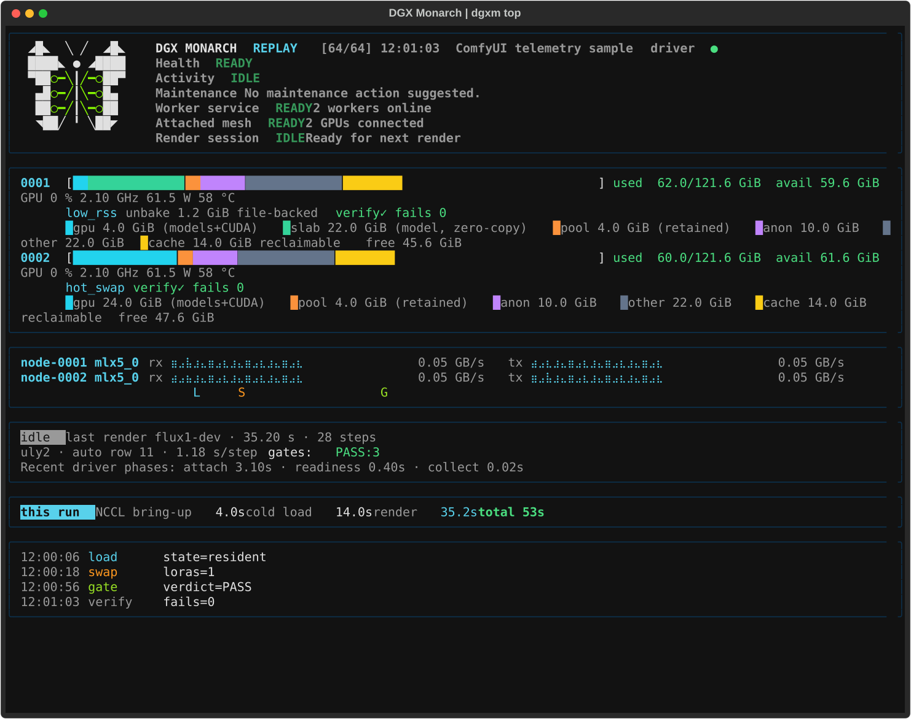

# dgxm top: live cluster dashboard

Terminology is defined in [CONCEPTS.md](CONCEPTS.md).

```
dgxm top                      # live dashboard; finds every local ComfyUI that
                              # has this node pack and prefers one with a live
                              # mesh (:8188 and :8191 are checked even when
                              # process discovery is unavailable)
dgxm top --host 127.0.0.1:8189   # skip discovery and use this driver
dgxm top --record run.jsonl   # also append every tick to a file
dgxm top --replay run.jsonl   # scrub a recording instead of live data
dgxm top --theme ember        # spark (default) | ember | mono
dgxm top --interval 0.5       # poll every half-second (allowed: 0.1..3600)
dgxm --config PATH top        # label Worker services from another cluster.toml
```

`--config` is a global `dgxm` option, so it comes before `top`. The file
supplies the Worker service endpoints the dashboard labels.
The poll interval defaults to one second. Its bounds, 0.1 and 3600 seconds,
limit the one-hour history to 36,000 samples and keep timer values valid;
`dgxm top` rejects a value outside them before it starts.

`dgxm top` needs the optional `[tui]` extra, installed with the same
interpreter that starts ComfyUI. Installation commands and update behavior are
in [INSTALL.md](INSTALL.md#install-from-source).



Illustrative dashboard using sample data, not a benchmark result.

## What it shows

* **Per-box unified-memory bar:** gpu (models+CUDA), slab (model, zero-copy),
  retained pool, anon and other are five segments that never overlap and sum
  exactly to used memory (`MemTotal - MemAvailable`). Reclaimable cache and free
  split `MemAvailable`, so the six colored segments plus the uncolored free
  remainder add up to `MemTotal`. Used, total and available memory follow in
  GiB, and that text turns yellow when 20 GiB or less is available. GPU
  utilization, clock, power and temperature take the next line, and a reading
  the box does not send shows `unknown`, never zero. The legend under the bar names each
  segment; `slab` appears only when a model is slab-resident. `slab` and `pool`
  are residency terms; [CONCEPTS.md](CONCEPTS.md) defines both, and what
  reclaims the pool.
* **When the bar is unknown:** a Worker reports a slab size only while a slab
  holds its model, so a Worker that reports another weight residency, or no
  resident model, draws a bar with no slab segment. The row reads
  `memory breakdown unknown` and shows only total and available memory when the
  box sends no host counters, when its Worker sent `memory_error` or no memory
  report, or when the Worker reports slab residency without a size. A row
  reads `memory unknown` when the box sends no usable total or available
  memory. A box that no Worker reports, such as a driver-only box or this box
  while the driver is down, also draws its bar with no slab segment, so a slab
  that a Worker still holds there counts as other.
* **Colors:** every theme draws the six memory segments in the ComfyUI
  sidebar's colors: gpu cyan, slab green, pool orange, anon purple, other grey
  and cache yellow. `ember` changes only the accent color, and `mono` draws six
  grey levels. A truecolor terminal shows the sidebar's exact colors and a
  256-color terminal shows fixed colors from its 256-color table. Neither uses
  one of the sixteen standard ANSI colors, so a terminal palette change cannot
  merge two segments there. A 16-color terminal, such as `TERM=xterm`, `screen`
  or `linux` without `COLORTERM`, has only the standard colors, so the six
  segments take six different ones: cyan, green, bright red, magenta, white and
  yellow. The terminal's own palette then decides how they look. On such a
  terminal `mono` has only three visible greys, so two of its segments can look
  alike; choose `spark` or `ember` there. With `NO_COLOR` set the bar has no
  color, and the legend values tell the segments apart.
* **RDMA rails:** one row per rail on every box, with RX and TX GB/s shown
  separately, each with its own braille history graph. The
  counters are `/sys/class/infiniband/*/ports/*/counters/port_{rcv,xmit}_data`.
  A rate is timed by the box's own stamps of when it read the counters, so a
  reading that waited in the driver's cache does not read fast or slow. A
  device with one cabled port shows under its own name. A device with more
  than one shows each port as `<device>/<port>`, the same key the link state
  and the `/dgxm/metrics` rail label use. During a sequence-parallel render,
  the all-to-all traffic shows as one pulse per denoise step. In
  `/dgxm/telemetry`, each box's readings (the driver's `driver_host` block and
  each worker's `host` block) carry `rails`, the cumulative RX and TX bytes per
  rail; `rail_state`, the port state and physical state per rail; `rails_m`,
  the box's monotonic time of the reading, which readers use to time a rate; and
  `rails_t`, the wall-clock time of the same reading, for display only.
* **Render line:** live step progress (fed by the driver's own progress
  channel), seconds per step and the estimated time remaining, or, when idle,
  the last render's model, duration and steps, then the gate ledger's count of
  each verdict. A step count the driver does not send reads `unknown`, with no
  progress bar or estimate. The label names the active stage, such as
  `gate proof 2 of 2-4`, `cross-residency check`, or `render`.
* **Driver phases:** under the render line, in `dgxm top` and in the sidebar,
  `Recent driver phases:` names the driver's last four completed phases, such
  as `attach`, `readiness`, `collect` or `recycle`, each with its seconds, and
  in parentheses any outcome other than `ok`. The timings come from the
  `diagnostics` block of `/dgxm/telemetry`. The line reads
  `No completed driver phases recorded` before the first one,
  `Phase timings unavailable` when the driver sends no usable block, and
  `Phase timings unavailable or stale` without a fresh driver report. The
  timings are advisory and never decide health or readiness.
* **Run summary:** a first-use request runs NCCL setup, loads the model, and
  performs the gate's reference and residency checks before rendering. The
  summary lists each stage, its duration, and the total until the
  next request.
* **Health, activity, and maintenance:** healthy rendering shows `Health READY`
  and `Activity RENDERING`, with a message to wait before maintenance. Other
  active mesh work shows `BUSY`; activity does not hide unknown health or a
  blocker. Older server payloads retain the legacy `Readiness` label with an
  explanation of its active-work degradation. These labels are advisory, not
  authority to change worker or mesh state. CLI JSON preserves its original
  aggregate and adds the separate presentation fields used here and in the
  browser panel. [CONCEPTS.md](CONCEPTS.md#operator-words) holds the observation
  and compatibility rules.
* **low_rss state per box:** LoRA mode, unbake file-backed GiB and the
  ambient-verify failure count (red when nonzero).
* **Event ticker and markers:** swaps (with phase timings), loads, gate
  verdicts, and quarantines appear as events in the ticker and as a marker glyph
  (S, G, L, Q) under the rail graphs. First-render notices (NCCL bring-up, cold
  load, and identity-gate phases) stay in the ticker only, so they cannot
  overwrite a marker.

The ComfyUI memory sidebar draws a worker's card only after that worker's full
host-memory report arrives, so a worker still starting up never shows a card of
default values or hides valid driver telemetry. A driver on its own host keeps
its card beside the workers; on a worker's host, that worker's card replaces
the driver's. Each card's title gives used, total and available memory in GiB,
green above 20 GiB available and yellow at or below. The card's bar and legend
follow the same rules as `dgxm top`, including when they read
`memory breakdown unknown`. A Fleet row's wall time reads `unknown` when the
driver recorded none; `0.00 s` is a measured zero.

Above the cards, one sidebar line names the topology the workers set up, such
as `uly2` or `uly2+fsdp`, and names each one when workers disagree. Each card
adds one line for its box's RDMA rails: RX and TX GB/s per rail between two
readings of its counters, and in red the port state of a rail that is not
ACTIVE. The panel reads each box's rails once per poll, so a box that runs two
ranks shows the same rates on both of its cards. A rail appears when it
carries traffic, or when its link is physically up but its port is down. An
unused or uncabled port stays off the line, and so does a rail that never
trained at boot, because sysfs reads it the same as an uncabled port;
`dgxm doctor` reports that rail. When the panel is idle, the last render's
line also names the topology it ran, its auto table row, its last seconds per
step, and any attention kernel the model pinned per attention module, with
whether it ran
([TROUBLESHOOTING #117](TROUBLESHOOTING.md#117-a-render-refuses-because-the-checkpoint-or-a-lora-pins-an-attention-kernel)).
When both models of a dual-model cfg2 render pin, that part gives one clause
per model, such as
`pinned: cond model: ..., ran; uncond model: ..., dropped (...)`.
Each render times a step against its own previous step, so the
second leader of a dp>1 render, or another render in the same Fleet wave,
cannot shrink that number to the gap between two messages. `dgxm top` draws
the same facts on a second line under its idle render line. Both read them from
the `render.last` block of `/dgxm/telemetry`.

That block holds `model`, `steps`, `wall_s` (the whole render, cold load and
any gate included), `ended_at`, `ceremony` (whether the render paid a
first-use identity gate), `topology`, `attention` (the Init widget's kernel)
and `sec_per_step` (the last step's time). `sample_s` is the slowest rank's
sampler time and `mean_step_s` is `sample_s` over the render's own steps, so
neither holds load or gate time. The auto facts are `auto_row`, `family`,
`quant`, `megapixels`, `cfg`, `keeps_uncond` (whether the sampler keeps the
negative pass at CFG 1, as the cfg++ samplers do), `evidence_row` (the record
that admitted cfg2), `skipped_cfg_row` (a cfg row auto passed over for want of
evidence) and `batch`. A preset leaves them null, and a one-GPU render has no
`auto_row`. When the render re-attached after a Worker restart, `reattach`
reads `restart_reattach` and `reattach_s` gives the re-attach seconds; both
are null otherwise. The pin fields `attention_pins`, `attention_pins_ran` and
`attention_pins_dropped`, plus `attention_pins_models` when both models of a
dual-model cfg2 render pin, are described in
[TROUBLESHOOTING #117](TROUBLESHOOTING.md#117-a-render-refuses-because-the-checkpoint-or-a-lora-pins-an-attention-kernel).

## Butterfly header

The Monarch butterfly appears beside the status lines on terminals at least
100 columns wide. Smaller terminals keep the name and leave room for telemetry.
The wings appear over the first second without delaying polling or navigation.
A pulse moves along the green circuits only while a recent driver sample reports an active render;
idle, paused, and replay views stay still. Press `a` to turn animation off.

The mark uses green independently of the memory palette and status indicators.
The `mono` theme and `NO_COLOR` remove its color. Terminals with an incompatible
output encoding use an ASCII butterfly; `TERM=dumb` also disables its animation.

## Record and replay

Arrow keys scrub from `LIVE` (`←` auto-pauses; scrubbing `→` past the newest
tick resumes `LIVE`); `space` toggles pause. `s` saves the ring to a
timestamped JSONL file. `dgxm top --replay` reproduces the recorded dashboard
state. A recording is a full-fidelity private diagnostic, not a
disclosure-reduced receipt: it can contain host and network identity, worker
endpoints, model and render detail, events, and ledger summaries. Do not
attach it unreviewed to a public bug report. Redact it to the narrow evidence
needed, or use the private security-reporting path when disclosure is
sensitive. Recording writes require one owner-held, non-symlink regular file
with mode `0600`; an existing target that does not meet these requirements is
refused. The run block and render label follow the selected tick. The
dashboard retains the latest 4,096 events and refreshes existing entries when
the route resends them, without marking unchanged events as new.

A poll that began before a pause or scrub is discarded, even if the view is
back on `LIVE` when it returns; only a later live poll publishes. A malformed
response or a normalization failure records a fresh `UNKNOWN` tick instead of
leaving an older healthy tick on screen. If only the run story fails, its block
shows `run story unavailable (<exception type>)` and the other panels keep
redrawing.

## Keys

`q` quit · `space` pause/scrub · `←/→` scrub · `a` animations · `t` theme ·
`s` save recording · `l` gate ledger · `w` worker detail

## Data sources and isolation

The dashboard reads two sources without changing either: the driver's
`/dgxm/telemetry` HTTP route, which ComfyUI serves with live state, and the
local host (sysfs, bounded `/proc` reads, and pynvml or nvidia-smi).
`dgxm top` never attaches a second Monarch client, opens a Monarch worker
socket, or runs SSH. The driver collects passive Worker service checks
separately from actor telemetry; see [Readiness](CONCEPTS.md#operator-words).
Worker, mesh and readiness indicators use only what the driver reports; without an exact report, including while the driver is down,
they show `?` (unknown), and local data keeps the rest of the dashboard
live. `dgxm status` gives the passive Worker service and Attached mesh facts,
and `dgxm status --json` adds readiness. `dgxm doctor` runs the full cluster
preflight; `dgxm doctor --json` adds readiness and keeps the same checks,
counts and exit codes. Doctor JSON is a full-fidelity diagnostic surface, not a
disclosure-reduced operator receipt: review and redact it before you share it.
[CONCEPTS.md](CONCEPTS.md#operator-words) gives each surface's observation
limits.

The retained-pool `/proc/*/smaps` scan has a 0.5-second total budget. An
incomplete scan keeps the last complete pool value instead of publishing a
partial total, so polling stays responsive with the driver down. Telemetry
event tails have a fixed schema and hold at most 256 entries; text and list
fields are bounded too, and non-finite JSON numbers become `null`. Worker
telemetry reports setup cleanup only as the boolean `setup_cleanup_failed`:
`true` blocks readiness, malformed evidence is `unknown`, and private setup
detail is excluded from telemetry.

A worker answers its 10 s status call on the same actor that runs the render,
so a refresh against saturated workers can time out. The route then serves its
last good snapshot and logs one INFO note per render. It warns instead when the
fleet is idle, when the failure is not a timeout, or when it has no good
snapshot to serve ([docs/TROUBLESHOOTING.md #58](TROUBLESHOOTING.md#58-worker-status-poll-timed-out-while-a-render-is-in-flight)).

`/dgxm/metrics` serves the numeric subset as Prometheus text exposition for
Grafana-compatible monitoring.

---
See [VALIDATION.md](VALIDATION.md) for hardware test results. Dashboard
illustrations use sample data.
